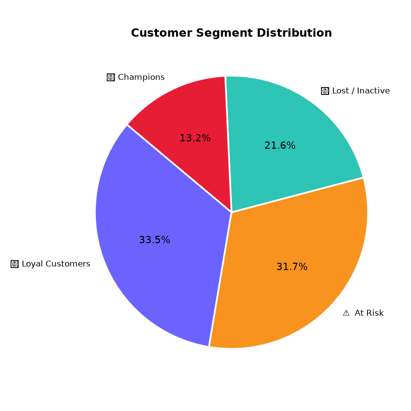
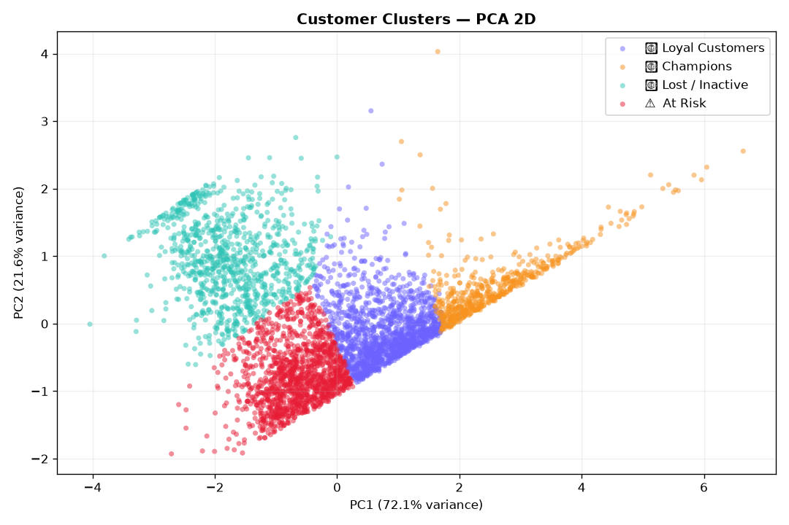
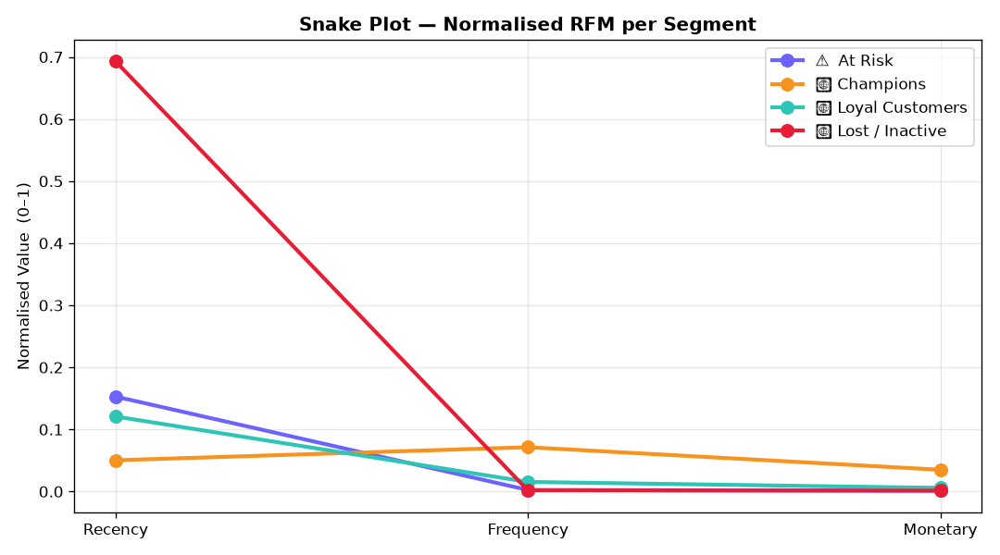
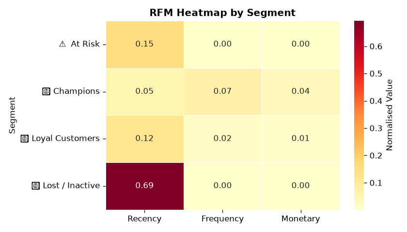
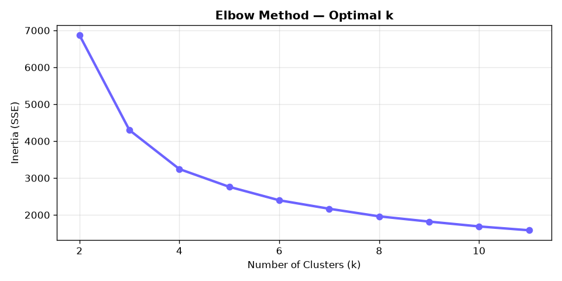
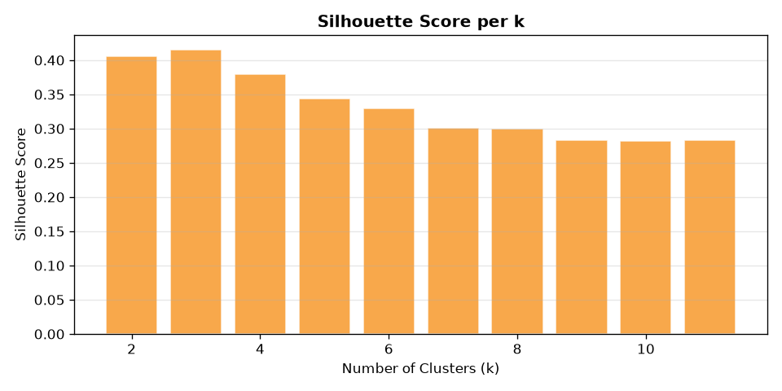
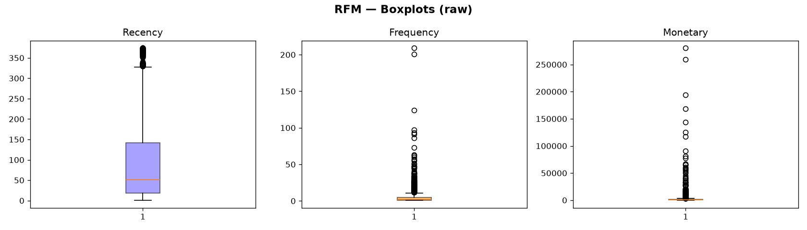
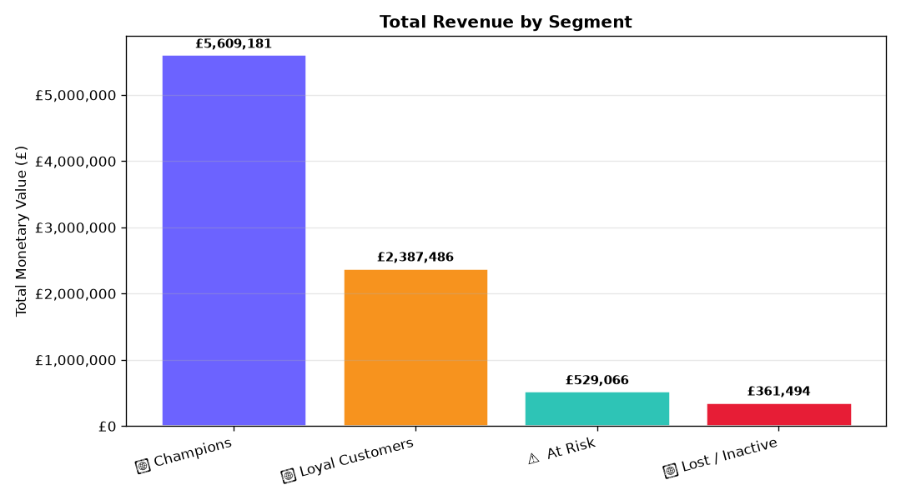

# 🛍️ Customer Segmentation — RFM + K-Means


> **Segment e-commerce customers into actionable groups using RFM analysis and K-Means clustering.**

---

## 📌 Problem Statement

Not all customers are equal. A retailer needs to know **who are the VIPs**, **who is at risk of churning**, and **who has already left** — so they can apply the right marketing strategy to each group.

This project solves that by:
1. Computing an **RFM score** for every customer
2. Clustering customers automatically with **K-Means**
3. Producing **marketing recommendations** per segment
4. Presenting results in an interactive **Streamlit dashboard**

---

## 📸 Dashboard Preview

| Overview | RFM Explorer |
|----------|-------------|
|  |  |

| Segment Profiles — Snake Plot | Segment Profiles — Heatmap |
|-------------------------------|---------------------------|
|  |  |

| Elbow Method | Silhouette Score |
|-------------|-----------------|
|  |  |

| RFM Distributions | Revenue by Segment |
|-------------------|--------------------|
|  |  |

---

## 📂 Dataset

| Property | Value |
|----------|-------|
| Source | [UCI Online Retail II](https://archive.ics.uci.edu/ml/datasets/Online+Retail+II) |
| Period | 2009 – 2011 |
| Transactions | ~1,000,000 rows |
| Customers | ~5,900 unique |
| Country | United Kingdom (mainly) |

**Key columns:** `Invoice`, `StockCode`, `Description`, `Quantity`, `InvoiceDate`, `Price`, `Customer ID`, `Country`

---

## 🔬 Methodology

```
Raw Data → Cleaning → RFM Calculation → Log-Transform → StandardScaler
    → Elbow Method + Silhouette → K-Means (k=4) → Profiling → Recommendations
```

### RFM Metrics

| Metric | Formula |
|--------|---------|
| Recency | Days between last purchase and snapshot date |
| Frequency | Number of distinct invoices |
| Monetary | Sum of (Quantity × Price) |

### Cleaning Steps
- Dropped rows with missing `Customer ID`
- Removed cancelled orders (Invoice starts with `'C'`)
- Removed negative or zero `Quantity` / `Price`
- Removed duplicates

### Normalisation
- **Log1p transform** on Frequency & Monetary (right-skewed)
- **StandardScaler** to zero-mean, unit-variance

---

## 📊 Results

| Segment | Customers | Avg Recency | Avg Frequency | Avg Monetary |
|---------|-----------|-------------|---------------|--------------|
| 🏆 Champions | ~13% | Low | High | High |
| 💛 Loyal Customers | ~34% | Medium | Medium | Medium |
| ⚠️ At Risk | ~32% | High | Low-Med | Medium |
| 💤 Lost / Inactive | ~21% | Very High | Very Low | Low |

---

## 📣 Marketing Recommendations

| Segment | Actions |
|---------|---------|
| 🏆 **Champions** | VIP rewards, early access, ask for referrals |
| 💛 **Loyal** | Upsell, cross-sell, personalised emails |
| ⚠️ **At Risk** | Win-back campaign, discount, re-engagement sequence |
| 💤 **Lost** | Last-chance offer, churn survey |

---

## 🚀 How to Run

### 1. Clone the repo
```bash
git clone https://github.com/douhabrihab6-lang/customer-segmentation-rfm.git
cd customer-segmentation-rfm
```

### 2. Install dependencies
```bash
pip install -r requirements.txt
```

### 3. Download the dataset
- Go to: https://archive.ics.uci.edu/ml/datasets/Online+Retail+II
- Download `online_retail_II.xlsx` → place in `data/`

### 4. Run the notebook
```bash
jupyter notebook notebooks/rfm_kmeans_segmentation.ipynb
```

### 5. Launch the Streamlit dashboard
```bash
streamlit run streamlit_app/app.py
```
The dashboard opens at **http://localhost:8501**

---

## 🗄️ SQL Queries

The [`sql/rfm_analysis.sql`](sql/rfm_analysis.sql) file contains **6 sections** of ready-to-run queries (PostgreSQL / MySQL / SQLite compatible):

| Section | Description |
|---------|-------------|
| **0 — Schema Setup** | `CREATE TABLE` for raw data and RFM segments |
| **1 — Data Exploration** | Row counts, date range, missing values, top countries & products, monthly trend |
| **2 — Data Cleaning** | Reusable `v_clean_retail` view that removes nulls, cancellations & bad values |
| **3 — RFM Calculation** | Full RFM derivation with snapshot date in pure SQL |
| **4 — Segment Analysis** | Count / share / descriptive stats per segment |
| **5 — Business Insights** | Top VIPs, at-risk high-value customers, win-back lists, Pareto check |
| **6 — KPI Dashboard** | Single query returning all headline KPIs |

**Example — Revenue at Risk:**
```sql
SELECT
    segment,
    ROUND(SUM(monetary), 2) AS revenue_at_risk
FROM rfm_segments
WHERE segment LIKE '%At Risk%' OR segment LIKE '%Lost%'
GROUP BY segment;
```

---

## 🗂️ Project Structure

```
customer-segmentation-rfm/
├── data/
│   ├── online_retail_II.xlsx           # raw dataset (not tracked by git)
│   └── rfm_clustered.csv               # output with cluster labels
├── notebooks/
│   ├── rfm_kmeans_segmentation.ipynb   # main analysis notebook
│   └── rfm_segmentation.py             # standalone Python script
├── streamlit_app/
│   └── app.py                          # 4-page interactive dashboard
├── sql/
│   └── rfm_analysis.sql                # 6-section SQL query portfolio
├── assets/
│   └── screenshots/                    # saved chart PNGs (8 charts)
├── requirements.txt
└── README.md
```

---

## 🛠️ Tech Stack

| Tool | Purpose |
|------|---------|
| Python 3.13 | Core language |
| Pandas | Data wrangling & RFM |
| NumPy | Numerical ops |
| scikit-learn | StandardScaler, KMeans, silhouette |
| Matplotlib / Seaborn | Static visualisations |
| Plotly | Interactive charts |
| Streamlit | Dashboard app |
| SQL | Portfolio analytics queries |
| Jupyter Notebook | Analysis environment |

---

## 💼 CV Line

> **Customer Segmentation using RFM + K-Means (Python, scikit-learn, Streamlit)**  
> Analysed 1M+ transactions, identified 4 customer segments (Champions, Loyal, At Risk, Lost), produced targeted marketing recommendations and an interactive dashboard — reducing churn potential by identifying 53% of the customer base as at-risk or inactive.

---

## 👩‍💻 Author

**Rihab Douhab** — [GitHub](https://github.com/douhabrihab6-lang)
